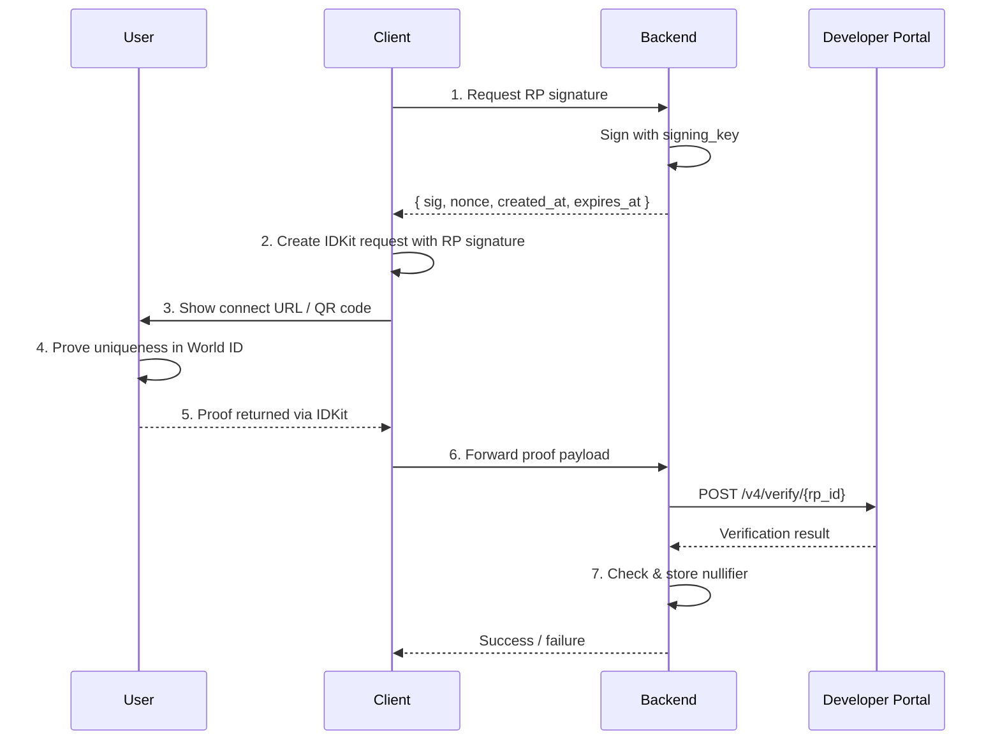

> ## Documentation Index
> Fetch the complete documentation index at: https://docs.world.org/llms.txt
> Use this file to discover all available pages before exploring further.

# IDKit

> Integrate World ID into your app

IDKit is the SDK for integrating World ID into your app. It handles proof requests, verification flows and communication with the World ID App, so your backend receives cryptographic proof of human, not personal data.

Use the React widget for drop-in integration, or the JS, Swift and Kotlin SDKs for custom flows. For the core concepts of World ID, see [this page](https://docs.world.org/world-id/concepts.md).

> Tip: To integrate faster, give your coding agent the [Build with LLMs prompt](https://docs.world.org/world-id/idkit/build-with-llms.md) — copy it once, then paste into Claude, Cursor or any AI coding assistant.

## How it works

Use IDKit to request a proof and verify it on your backend: follow this guide for one-time checks, or use [session proofs](https://docs.world.org/world-id/idkit/session-proofs.md) for returning users.


Four components are involved: your **client** (where IDKit runs), your **backend** (which signs requests and verifies proofs), the **World ID App** (on the user's device) and the **Developer Portal** (which validates proofs on-chain). The steps below cover each one.

# Step 1: Install IDKit

Use the latest `4.x` version.

**Install**

```bash title="JavaScript" theme={"system"}
npm i @worldcoin/idkit-core
```

```bash title="React" theme={"system"}
npm i @worldcoin/idkit
```

```swift title="Swift (SPM)" theme={"system"}
.package(url: "https://github.com/worldcoin/idkit-swift.git", from: "<version>")
```

```kotlin title="Kotlin (Gradle)" theme={"system"}
dependencies {
    implementation("com.worldcoin:idkit:<version>")
}
```

# Step 2: Create an app in the Developer Portal

Create your app in the [Developer Portal](https://developer.world.org). If you're migrating from an old app, complete RP registration by clicking the Enable World ID 4.0 banner. Keep these values:

* `app_id`
* `rp_id`
* `signing_key` - this should be stored as a secret.

# Step 3: Generate an RP signature in your backend

Signatures verify that proof requests come from your app, preventing impersonation attacks.

**Generate RP signature**

```typescript title="JavaScript" theme={"system"}
import { NextResponse } from "next/server";
import { signRequest } from "@worldcoin/idkit-core/signing";

export async function POST(request: Request): Promise<Response> {
  const { action } = await request.json();

  const { sig, nonce, createdAt, expiresAt } = signRequest({
    signingKeyHex: process.env.RP_SIGNING_KEY!,
    action,
  });

  return NextResponse.json({
    sig,
    nonce,
    created_at: createdAt,
    expires_at: expiresAt,
  });
}
```

```go title="Go" theme={"system"}
package main

import (
	"encoding/json"
	"net/http"
	"os"

	"github.com/worldcoin/idkit/go/idkit"
)

func handleRPSignature(w http.ResponseWriter, r *http.Request) {
	if r.Method != http.MethodPost {
		http.Error(w, "method not allowed", http.StatusMethodNotAllowed)
		return
	}

	var body struct {
		Action string `json:"action"`
	}
	_ = json.NewDecoder(r.Body).Decode(&body)

	sig, err := idkit.SignRequest(
		os.Getenv("RP_SIGNING_KEY"),
		idkit.WithAction(body.Action),
	)
	if err != nil {
		http.Error(w, err.Error(), http.StatusInternalServerError)
		return
	}

	w.Header().Set("content-type", "application/json")
	_ = json.NewEncoder(w).Encode(map[string]any{
		"sig":        sig.Sig,
		"nonce":      sig.Nonce,
		"created_at": sig.CreatedAt,
		"expires_at": sig.ExpiresAt,
	})
}
```

> [!WARNING]
>
> Never generate RP signatures on the client and never expose your RP signing
> key. If the key leaks, attackers can forge requests from your app.

> [!NOTE]
>
> The steps below cover the standard request flow. Depending on whether the user
> already has World ID and the credential you're requesting, they may see a
> different experience. See [Verification flows](https://docs.world.org/world-id/idkit/verification-flows.md)
> for details.

# Step 4: Generate the connect URL and collect proof

To test during development, use the [simulator](https://simulator.worldcoin.org/) and set `environment` to `"staging"`.

**Create request and collect proof**

```typescript title="JavaScript" theme={"system"}
import { IDKit, orbLegacy } from "@worldcoin/idkit-core";

const rpSig = await fetch("/api/rp-signature", {
  method: "POST",
  headers: { "content-type": "application/json" },
  body: JSON.stringify({ action: "my-action" }),
}).then((r) => r.json());

const request = await IDKit.request({
  // App ID: `app_id` from the Developer Portal
  app_id: "app_xxxxx",
  // Action: Context that scopes what the user is proving uniqueness for
  // e.g., "verify-account-2026" or "claim-airdrop-2026".
  action: "my-action",
  rp_context: {
    rp_id: "rp_xxxxx", // Your app's `rp_id` from the Developer Portal
    nonce: rpSig.nonce,
    created_at: rpSig.created_at,
    expires_at: rpSig.expires_at,
    signature: rpSig.sig,
  },
  allow_legacy_proofs: true,
  environment: "production", // Only set this to staging for testing with the simulator
  return_to: "myapp://verify-done", // Optional: mobile deep-link callback URL
  // Signal (optional): Bind specific context into the requested proof.
  // Examples: user ID, wallet address. Your backend should enforce the same value.
}).preset(orbLegacy({ signal: "local-election-1" }));

const connectUrl = request.connectorURI;
const response = await request.pollUntilCompletion();
```

```tsx title="React" theme={"system"}
import {
  IDKitRequestWidget,
  orbLegacy,
  type RpContext,
} from "@worldcoin/idkit";

const rpSig = await fetch("/api/rp-signature", {
  method: "POST",
  headers: { "content-type": "application/json" },
  body: JSON.stringify({ action: "my-action" }),
}).then((r) => r.json());

const rp_context: RpContext = {
  rp_id: "rp_xxxxx", // Your app's `rp_id` from the Developer Portal
  nonce: rpSig.nonce,
  created_at: rpSig.created_at,
  expires_at: rpSig.expires_at,
  signature: rpSig.sig,
};

// ...
 
<IDKitRequestWidget
  open={open}
  onOpenChange={setOpen}
  app_id="app_xxxxx" // Your app's `app_id` from the Developer Portal
  // Action: Context that scopes what the user is proving uniqueness for
  // e.g., "verify-account-2026" or "claim-airdrop-2026".
  action="my-action"
  rp_context={rp_context}
  allow_legacy_proofs={true}
  // Signal (optional): Bind specific context into the requested proof.
  // Examples: user ID, wallet address. Your backend should enforce the same value.
  preset={orbLegacy({ signal: "local-election-1" })}
  handleVerify={async (result) => {
    const response = await fetch("/api/verify-proof", {
      method: "POST",
      headers: { "content-type": "application/json" },
      body: JSON.stringify({
        rp_id: rp_context.rp_id,
        idkitResponse: result,
      }),
    });

    if (!response.ok) {
      throw new Error("Backend verification failed");
    }
  }}
  onSuccess={(result) => {
    // Runs after `handleVerify` succeeds. Update app state/UI here.
  }}
/>;
```

```swift title="Swift" theme={"system"}
import IDKit

// Fetch the RP signature from your backend
let rpSig = try await yourBackend.fetchRpSignature(action: "my-action")

let rpContext = try RpContext(
  rpId: "rp_xxxxx", // Your app's `rp_id` from the Developer Portal
  nonce: rpSig.nonce,
  createdAt: rpSig.createdAt,
  expiresAt: rpSig.expiresAt,
  signature: rpSig.sig
)

let config = IDKitRequestConfig(
  // App ID: `app_id` from the Developer Portal
  appId: "app_xxxxx", 
  // Action: Context that scopes what the user is proving uniqueness for
  // e.g., "verify-account-2026" or "claim-airdrop-2026".
  action: "my-action",
  rpContext: rpContext,
  actionDescription: "Verify user",
  bridgeUrl: nil,
  allowLegacyProofs: true,
  overrideConnectBaseUrl: nil,
  environment: .production
)

// Signal (optional): Bind specific context into the requested proof.
// Examples: user ID, wallet address. Your backend should enforce the same value.
let request = try IDKit.request(config: config).preset(orbLegacy(signal: "local-election-1"))
let connectUrl = request.connectorURL
let completion = await request.pollUntilCompletion()
```

```kotlin title="Kotlin" theme={"system"}
import com.worldcoin.idkit.IDKit
import com.worldcoin.idkit.IDKitRequestConfig
import com.worldcoin.idkit.RpContext
import com.worldcoin.idkit.Environment
import com.worldcoin.idkit.orbLegacy

// Fetch the RP signature from your backend (see Step 2)
val rpSig = yourBackend.fetchRpSignature(action = "my-action")

val rpContext = RpContext(
  rpId = "rp_xxxxx", // Your app's `rp_id` from the Developer Portal
  nonce = rpSig.nonce,
  createdAt = rpSig.createdAt.toULong(),
  expiresAt = rpSig.expiresAt.toULong(),
  signature = rpSig.sig,
)

val config = IDKitRequestConfig(
  // App ID: `app_id` from the Developer Portal
  appId = "app_xxxxx", 
  // Action: Context that scopes what the user is proving uniqueness for
  // e.g., "verify-account-2026" or "claim-airdrop-2026".
  action = "my-action",
  rpContext = rpContext,
  allowLegacyProofs = true,
)

// Signal (optional): Bind specific context into the requested proof.
// Examples: user ID, wallet address. Your backend should enforce the same value.
val request = IDKit.request(config).preset(orbLegacy(signal = "local-election-1"))
val connectorURI = request.connectorURI
val completion = request.pollUntilCompletion()
```

### IDKit response

After the user completes the verification flow, IDKit returns one of the following response shapes, depending on the protocol version and proof type.

**IDKit response**

```json title="World ID 3.0 (Legacy)" theme={"system"}
{
  "protocol_version": "3.0",
  "nonce": "a1b2c3d4-e5f6-7890-abcd-ef1234567890",
  "action": "my-action",
  "environment": "production",
  "responses": [
    {
      "identifier": "orb",
      "signal_hash": "0x00c5d2460186f7233c927e7db2dcc703c0e500b653ca82273b7bfad8045d85a4",
      "proof": "0x1a2b3c...encoded_proof",
      "merkle_root": "0x0abc123...root_hash",
      "nullifier": "0x04e5f6...nullifier_hash"
    }
  ]
}
```

```json title="World ID 4.0 Uniqueness" theme={"system"}
{
  "protocol_version": "4.0",
  "nonce": "a1b2c3d4-e5f6-7890-abcd-ef1234567890",
  "action": "my-action",
  "environment": "production",
  "responses": [
    {
      "identifier": "proof_of_human",
      "signal_hash": "0x0",
      "proof": ["0x1a2b...", "0x3c4d...", "0x5e6f...", "0x7a8b...", "0x9c0d..."],
      "nullifier": "0x04e5f6...rp_scoped_nullifier",
      "issuer_schema_id": 1,
      "expires_at_min": 1756166400
    }
  ]
}
```

```json title="Selfie Check" theme={"system"}
{
  "protocol_version": "4.0",
  "nonce": "a1b2c3d4-e5f6-7890-abcd-ef1234567890",
  "action": "selfie-check-2026-09-02",
  "environment": "production",
  "integrity_bundle": {
    "version": 2,
    "signature_format": "apple_app_attest",
    "timestamp": 1788302923,
    "signature": "a1b2c3d4...device_signature",
    "jwt": "eyJ...attestation_jwt"
  },
  "responses": [
    {
      "identifier": "selfie",
      "signal_hash": "0x0",
      "proof": ["0x1a2b...", "0x3c4d...", "0x5e6f...", "0x7a8b...", "0x9c0d..."],
      "nullifier": "0x04e5f6...rp_scoped_nullifier",
      "issuer_schema_id": 11,
      "expires_at_min": 1788302888,
      "sybil_score": 10
    }
  ]
}
```

```json title="World ID 4.0 Session" theme={"system"}
{
  "protocol_version": "4.0",
  "nonce": "a1b2c3d4-e5f6-7890-abcd-ef1234567890",
  "session_id": "session_5f3a9c2e...8d1b0a",
  "environment": "production",
  "responses": [
    {
      "identifier": "proof_of_human",
      "signal_hash": "0x0",
      "proof": ["0x1a2b...", "0x3c4d...", "0x5e6f...", "0x7a8b...", "0x9c0d..."],
      "session_nullifier": ["0x04e5f6...session_nullifier", "0x07a8b9...generated_action"],
      "issuer_schema_id": 1,
      "expires_at_min": 1756166400
    }
  ]
}
```

# Step 5: Verify the proof in your backend

After completion, send the returned payload to your backend and
forward it directly to `POST https://developer.world.org/api/v4/verify/{rp_id}`. Check that the verify response’s `environment` matches your backend’s expected environment (assert `"production"` for production integrations).

> [!NOTE]
>
> Forward the IDKit result payload as-is. No field remapping is required.

```typescript title="app/api/verify-proof/route.ts" theme={"system"}
import { NextResponse } from "next/server";
import type { IDKitResult } from "@worldcoin/idkit";

export async function POST(request: Request): Promise<Response> {
  const { rp_id, idkitResponse } = (await request.json()) as {
    rp_id: string;
    idkitResponse: IDKitResult;
  };

  /*
   * Set the expected environment on your backend. Reject proofs from other
   * environments before verification, including staging and sandbox in production.
   */
  const expectedEnvironment = "production";

  if (idkitResponse?.environment !== expectedEnvironment) {
    return NextResponse.json({ error: "Verification failed" }, { status: 400 });
  }

  const response = await fetch(
    `https://developer.world.org/api/v4/verify/${rp_id}`,
    {
      method: "POST",
      headers: { "content-type": "application/json" },
      body: JSON.stringify({
        ...idkitResponse,
        environment: expectedEnvironment,
      }),
    },
  );

  if (!response.ok) {
    return NextResponse.json({ error: "Verification failed" }, { status: 400 });
  }

  const verification = await response.json();

  if (
    verification?.success !== true ||
    verification?.environment !== expectedEnvironment
  ) {
    return NextResponse.json({ error: "Verification failed" }, { status: 400 });
  }

  // Uniqueness: store the nullifier (Step 6).
  // Sessions: validate and store the session result (see the session guide).
  return NextResponse.json({ success: true });
}
```

# Step 6: Store the nullifier

This step applies to uniqueness requests. For session proofs, follow the
[session guide](https://docs.world.org/world-id/idkit/session-proofs.md).

Every uniqueness proof contains a nullifier — a value derived from the user's World ID, your app, and the action. The same person verifying the same action always produces the same nullifier, but different apps or actions produce different ones, making nullifiers unlinkable across apps.

The Developer Portal confirms the proof is **cryptographically valid**, but your backend must check that the nullifier hasn't been used before. Otherwise, the same person could verify multiple times for the same action.

Nullifiers are returned as 0x-prefixed hex strings representing 256-bit integers. Convert and store them as numbers to avoid parsing and casing issues that can lead to security vulnerabilities. For example, PostgreSQL doesn't natively support 256-bit integers, so convert the nullifier to a decimal and store it as `NUMERIC(78, 0)`.

```sql title="PostgreSQL schema" theme={"system"}
CREATE TABLE nullifiers (
  nullifier   NUMERIC(78, 0) NOT NULL,
  action      TEXT NOT NULL,
  verified_at TIMESTAMPTZ NOT NULL DEFAULT NOW(),
  UNIQUE (nullifier, action)
);
```

## Architecture detail



## Next pages

* [RP Signatures](https://docs.world.org/world-id/idkit/signatures.md) — algorithm details, pseudocode, and test vectors
* [POST /v4/verify reference](https://docs.world.org/api-reference/developer-portal/verify.md)


This documentation is built and hosted on [Mintlify](https://mintlify.com), a developer documentation platform.